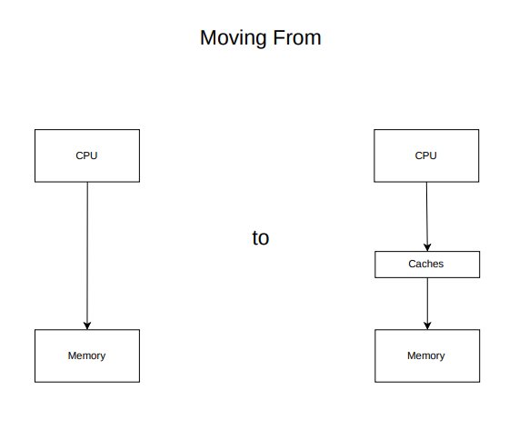
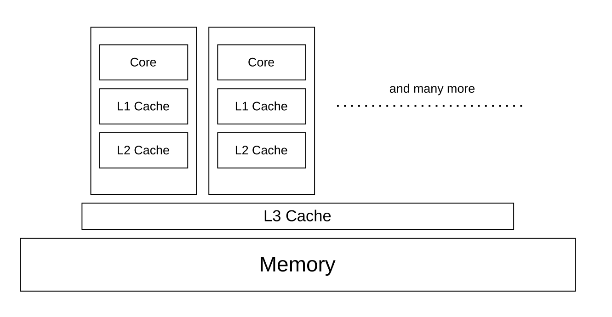

Have you ever wondered why people keep a water bottle of water while sleeping, they can go the water purifier at night  why need to keep a bottle? Because its faster. simlar things happen in our CPU. Our CPU stores a small amout of data near him to have fast access to those, it can’t run to main memory everytime it needs something.
Moving from simple memory structure to caches structures

<figure markdown="span">
  { width="420" loading=lazy }
  <figcaption>From CPU → memory to  CPU → caches → memory.</figcaption>
</figure>

### Memory model

In CPU multiple level of caches exists at various levels being called L1,L2 and L3. L1 is the closest to the CPU processing unit and the fastest allocating small amount of memory , L2 being slower and larger and L3 being the slowest and largest. THe following figures shows the cache structure in detail.


<figure markdown="span">
  { width="640" loading=lazy }
  <figcaption>Cache Structure</figcaption>
</figure>

How to check CPU caches in your own PC?

```bash title="Command"
lscpu | grep "cache"
```

```text title="Output (on my PC)"
L1d cache:                               352 KiB (10 instances)
L1i cache:                               576 KiB (10 instances)
L2 cache:                                6.5 MiB (4 instances)
L3 cache:                                12 MiB (1 instance)
```

Now going over each cache in detail:

L1 Cache : It is the fastest cache, easily accessible from cpu , its genrally in few kBs. Each core generally have each. It is divided in two parts: Instruction Cache L1i which stores the assembly instructions to be accessed , and the Data Cache which stores the variables,arrays,vectors for faster processing.

L2 and L3 Cache: Going Higher in number increases memory and and also the the time in which that cache can be accesed.


Some cool facts:

1. L1 cache is sort of built in chip. L2 very close to the chip or the motherboard.

2. The instruction caches are more fast , as instructions are easier to predict, as they mostly go in sequences. the predicts are mostly correct. In case of data it is difficult, as assuming if going in sequence it is not necessary the access to next variable needed by the instruction can be anywhwere.

/// Going Further draft

Array traversal

Assume u have a matrix, you can go row by row and column by column. row by row is faster. because arrat traversal row wise is fast, as memory is allocated together

A scalibity call , to count odd numbers divide matrix into rows, count odd elements seperately in each thread and return the results. after certain threads performance decreases.

If you add a local variable  , update that in a thread then update in main array at end , then it becomes scalable


Caches are organized in cache lines, if i call for 1 byte that i care about, the whole line will be brought up from the memory.

Explains why row major performance is better because u get the whole cache line, in row major u need to pull cache line for each byte.

Cache Prefetching, the hardware predicts which way you are going, and it pulls the data or instruction from the main memory , before even call and avoids memory latency

## References

- [Cache Warming & Prefetching: C++ Performance Guide](https://towardsdev.com/cache-warming-prefetching-cpp-performance-guide-68b2f693af56) — Towards Dev
- [Types of Cache](https://www.geeksforgeeks.org/system-design/types-of-cache/) — GeeksforGeeks
- [View size of CPU cache through the command line](https://askubuntu.com/questions/724449/view-size-of-cpu-cache-through-the-command-line) — Ask Ubuntu
- [What is the difference between L1 cache and L2 cache?](https://stackoverflow.com/questions/3699582/what-is-the-difference-between-l1-cache-and-l2-cache) — Stack Overflow
- https://www.youtube.com/watch?v=WDIkqP4JbkE&t=939s